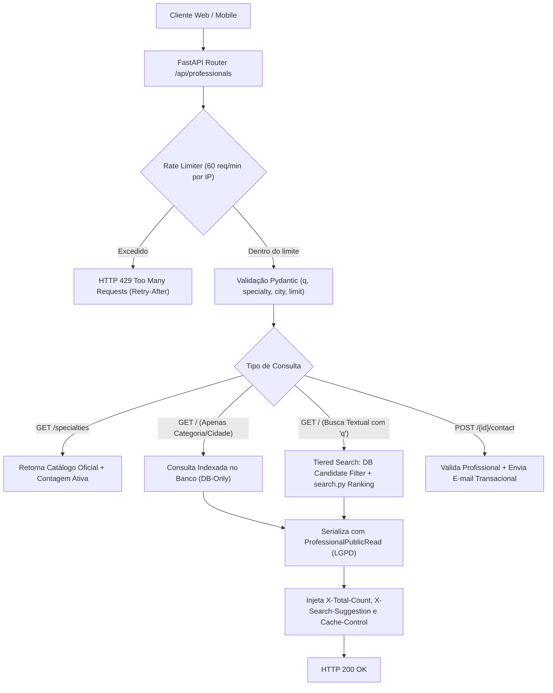
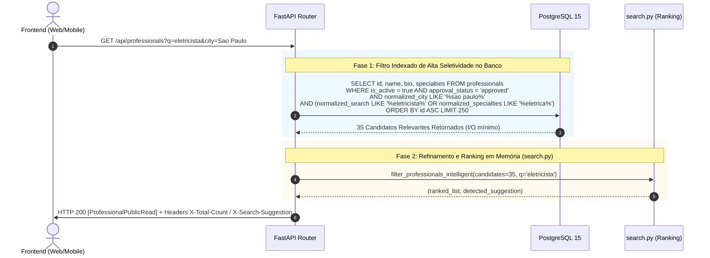
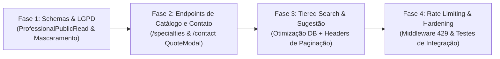

# 📋 PRD — Backend da Busca e Diretório de Profissionais por Categoria e Localização

| Metadado | Detalhe |
| :--- | :--- |
| **Projeto** | RentalSpouse — Plataforma de Serviços Residenciais ("Marido de Aluguel") |
| **Documento** | Product Requirements Document (PRD) — Backend da Busca e Diretório de Profissionais |
| **Arquivo** | `PRD_Backend_Busca_Profissionais.md` |
| **Issue Relacionada** | GitHub Issue #20 (História de Usuário Principal) & GitHub Issue #41 (Frontend Task) |
| **Issues de Suporte** | GitHub Issue #26 (Perfil Profissional), Issue #67 (Busca Inteligente), Issue #22 (Orçamentos) |
| **Versão** | `1.0.0` |
| **Status** | Aprovado para Desenvolvimento |
| **Escopo** | **EXCLUSIVAMENTE BACKEND** (`backend/`: FastAPI, SQLAlchemy 2.x, Pydantic v2, PostgreSQL/SQLite) |
| **Alinhamento com Frontend** | Totalmente compatível com `web/app/profissionais/page.tsx` e `mobile/screens/ProfessionalSearchScreen.js` |
| **Segurança & Compliance** | OWASP API Security Top 10, LGPD (Proteção de PII), Rate Limiting anti-scraping, Sanitização Estrita |

---

## 1. Visão Geral, Contexto e Diagnóstico

### 1.1 Contexto e História de Usuário (GitHub Issue #20)
> **História de Usuário**:
> *"#4 SENDO um cliente, EU QUERO buscar profissionais filtrando por categoria (elétrica, encanamento, montagem, etc.), PARA encontrar rapidamente a pessoa certa para o meu problema."*
> **Assignees**: @LucaS4nt0s (Luca Samuel dos Santos) e @MariaEduardaBatt (Maria Eduarda Batista Henrique).

O cliente do RentalSpouse acessa a plataforma em momentos de necessidade residencial crítica (vazamentos, falhas elétricas, montagens de urgência) ou manutenções planejadas. A busca por especialidade e localidade é o motor central de conversão e geração de valor da plataforma.

### 1.2 O Que Já Foi Desenvolvido (Status Quo)
1. **Frontend Web & Mobile (PR #56 / `PRD_Frontend_Busca_Profissionais.md`)**:
   - Página Web `/profissionais` em Next.js 14 (App Router) e tela Mobile em Expo.
   - Carrossel horizontal de chips de categorias, barra de pesquisa com debounce de 350ms sincronizada com a URL (`?specialty=...&city=...&q=...`).
   - Componentes visuais (`ProfessionalCard`, `CategoryChipsBar`, `FilterActionBar`, `QuoteModal`).
   - Hook de busca `useProfessionalsSearch.ts` consumindo `GET /api/professionals`.
   - Tratamento estrito dos 3 estados de UI: **Loading** (Skeletons com zero CLS), **Error** (com botão retry) e **Success/Data** (incluindo Empty State).
2. **Backend Atual (PR #67)**:
   - Módulo `backend/search.py` com normalização de acentos (`normalize_text`), cálculo de similaridade Damerau-Levenshtein, catálogo de sinônimos por especialidade e ranking ponderado por relevância.
   - Rota `GET /api/professionals` em `backend/routes/professionals.py` aceitando parâmetros `q`, `specialty`, `city`, `approval_status`, `skip` e `limit`.

---

### 1.3 Diagnóstico de Gaps: O Que Falta no Backend para Completar a Issue #20

Embora o filtro textual básico e o ranking estejam presentes, uma análise arquitetural aprofundada revela **6 lacunas críticas** que impedem o fechamento seguro e escalável da Issue #20:

```
┌────────────────────────────────────────────────────────────────────────────────────────┐
│                                GAPS DO BACKEND ATUAL                                   │
├──────────────────────────┬──────────────────────────────────────────┬──────────────────┤
│ Área                     │ Situação Atual                           │ Risco / Impacto  │
├──────────────────────────┼──────────────────────────────────────────┼──────────────────┤
│ 1. Privacidade & LGPD    │ Retorna e-mail e telefone em claro       │ Vazamento de PII │
│    (OWASP API3:2023)     │ para qualquer requisição anônima pública │ Multas LGPD      │
├──────────────────────────┼──────────────────────────────────────────┼──────────────────┤
│ 2. Contrato de Paginação │ Retorna lista plana sem contagem total;  │ Frontend força   │
│    e Envelope            │ frontend faz limit=100 para contar       │ limit=100 e faz  │
│                          │ e pagina localmente no cliente           │ paginação cega   │
├──────────────────────────┼──────────────────────────────────────────┼──────────────────┤
│ 3. Sugestão Inteligente  │ search.py calcula detected_suggestion,   │ Frontend forçado │
│    ("Você quis dizer?")  │ mas rota descarta o valor (retorna '_')  │ a recalcular no  │
│                          │                                          │ browser/mobile   │
├──────────────────────────┼──────────────────────────────────────────┼──────────────────┤
│ 4. Escalabilidade & DoS  │ MAX_SEARCH_CANDIDATES = 2000 trunca por  │ Omissão de dados │
│    (PR #67 Limitação)    │ ID e não por relevância; Damerau na CPU  │ e DoS em buscas  │
│                          │ sem Rate Limiting na API pública         │ concorrentes     │
├──────────────────────────┼──────────────────────────────────────────┼──────────────────┤
│ 5. Catálogo Dinâmico de  │ Especialidades estão fixas no código;    │ Sem contagem real│
│    Especialidades        │ não há endpoint de categorias e métricas │ e risco de drift │
├──────────────────────────┼──────────────────────────────────────────┼──────────────────┤
│ 6. Canal do QuoteModal   │ QuoteModal no frontend simula envio via   │ Ação do cliente  │
│    ("Solicitar Orçamento")│ mock setTimeout sem endpoint no backend  │ não é entregue   │
└──────────────────────────┴──────────────────────────────────────────┴──────────────────┘
```

---

## 2. Pilares de Arquitetura e Engenharia de Segurança

### 2.1 Proteção de Dados Pessoais (LGPD & OWASP API3:2023 — Broken Object Property Level Authorization)
A Lei Geral de Proteção de Dados (Lei nº 13.709/2018, Art. 6º — Princípio da Necessidade e Segurança) proíbe a exposição indiscriminada de dados de contato (telefone celular e e-mail pessoal) de prestadores em endpoints públicos suscetíveis a robôs de raspagem (*web scraping* e telemarketing abusivo).

- **Princípio da Máscara no Servidor**:
  - Em requisições públicas de busca, o backend **NUNCA** deve retornar e-mail ou telefone em claro.
  - O backend passa a serializar o modelo seguro `ProfessionalPublicRead`:
    - E-mail e telefone são mascarados no próprio servidor (`jo***o@exemplo.com`, `(11) 9****-**45`).
    - Somente usuários autenticados com relacionamento ativo ou administradores têm acesso a dados diretos via endpoints protegidos.
- **Prevenção de Ataques de Enumeração**:
  - Parâmetros de identificação sequencial não expõem status de moderação não aprovados (`approval_status != 'approved'` é rigidamente omitido do público).

### 2.2 Controle de Recursos e Anti-Scraping (OWASP API4:2023 — Unrestricted Resource Consumption)
Como o endpoint `/api/professionals` executa algoritmos de alta densidade computacional (distâncias Damerau-Levenshtein e normalizações regex), ele é um alvo prioritário de negação de serviço (DoS) e scraping:

1. **Rate Limiting em Camada de Aplicação**:
   - Algoritmo de **Sliding Window / Token Bucket** por IP de origem.
   - Limite público de busca: **60 requisições por minuto por IP** para rotas de busca textual.
   - Quando excedido: Retorno de status `HTTP 429 Too Many Requests` com cabeçalho padrão `Retry-After: 60` e payload RFC 7807 (`detail: "Limite de buscas excedido. Aguarde alguns instantes."`).
2. **Defesas contra Consultas Exaustivas**:
   - `max_length=120` em `q`, `max_length=100` em `city` e `specialty`.
   - Rejeição imediata de termos compostos unicamente por metacaracteres `%`, `_`, `*`, `\`.
   - Limite rígido `limit <= 50` por requisição (eliminando `limit=100` irrestrito no banco).

### 2.3 Sanitização de Entrada & Prevenção de Injeção SQL e ReDoS (OWASP API8:2023)
- O backend sanitiza rigorosamente todos os query parameters através do Pydantic v2 e funções puras em `search.py`.
- O escape de curingas SQL (`_escape_like`) é mantido e estendido contra injeção de wildcards que forçam *full-table scans* intencionais.
- Limite de tokens na query (`MAX_QUERY_TOKENS = 8`, `MAX_TOKEN_LENGTH = 30`) para impedir ataques de complexidade quadrática em tempo de CPU.

### 2.4 Cabeçalhos de Segurança HTTP e Cache Eficiente
Respostas de catálogo e diretório devem conter:
- `X-Content-Type-Options: nosniff`
- `X-Frame-Options: DENY`
- `Referrer-Policy: strict-origin-when-cross-origin`
- `Cache-Control: public, max-age=30, stale-while-revalidate=60` para buscas por categoria sem termo textual livre (`q`), reduzindo até 80% da carga sobre o PostgreSQL em categorias populares (ex: Elétrica, Hidráulica).

---

## 3. Contrato de Integração com o Frontend Desenvolvido

### 3.1 Garantia de Retrocompatibilidade (Zero Breaking Changes)
O frontend já implementado em produção (`web/hooks/useProfessionalsSearch.ts`) consome a rota da seguinte forma:

```typescript
// Chamada atual do frontend web
const response = await fetch(
  `/api/professionals?specialty=${specialty}&approval_status=approved&limit=100`
);
const result: Professional[] = await response.json();
```

> ⚠️ **Diretriz de Compatibilidade**: A resposta padrão de `GET /api/professionals` deve continuar sendo um array JSON (`List[ProfessionalPublicRead]`), garantindo que o frontend atual continue funcionando 100% sem nenhuma alteração obrigatória de emergência.

Para entregar as capacidades avançadas (contagem total, paginação real e sugestão "Você quis dizer"), o backend adota **Estratégia Híbrida de Dupla Resposta**:
1. **Via Cabeçalhos HTTP Padronizados (Transparente para o Frontend Atual)**:
   - `X-Total-Count: 42` (Total de profissionais compatíveis com o filtro no banco).
   - `X-Search-Suggestion: Eletrica` (Sugestão de correção, se houver).
   - `X-Page: 1`
   - `X-Per-Page: 20`
   - `X-Has-More: true`
2. **Via Parâmetro de Envelope (`envelope=true` ou Rota Dedicada `/api/professionals/search`)**:
   - Permite que o frontend migre confortavelmente para o schema envelopado:
   ```json
   {
     "items": [...],
     "total": 42,
     "page": 1,
     "size": 20,
     "pages": 3,
     "has_more": true,
     "detected_suggestion": "Elétrica"
   }
   ```

### 3.2 Alinhamento com a Interface TypeScript (`web/types/professional.ts`)
O schema Pydantic serializado no backend deve corresponder rigorosamente à interface do cliente:

```typescript
export interface Professional {
  id: number;
  name: string;
  email: string;             // Mascarado no backend público
  phone?: string | null;     // Mascarado no backend público
  bio: string;
  service_radius_km: number;
  specialties: string[];
  city?: string | null;
  state?: string | null;
  is_active: boolean;
  approval_status?: string;
  created_at?: string;
}
```

---

## 4. Especificação Detalhada dos Endpoints



---

### 4.1 Endpoint 1: Busca e Diretório de Profissionais (`GET /api/professionals`)

- **Método**: `GET`
- **Caminho**: `/api/professionals` (e alias `/api/profissionais`)
- **Autenticação**: Pública (com Rate Limit por IP)
- **Sumário**: Listar e buscar profissionais qualificados com tolerância a erros e proteção de dados.

#### Parâmetros de Query (Entrada):
| Parâmetro | Tipo | Padrão | Validação / Restrição | Descrição |
| :--- | :--- | :--- | :--- | :--- |
| `q` | `string` | `None` | `max_length=120`, sanitizado | Termo textual livre (nome, especialidade, bio ou sinônimo) |
| `specialty` | `string` | `None` | `max_length=100` | Filtro por especialidade exata ou normalizada ("Todas" = sem filtro) |
| `city` | `string` | `None` | `max_length=100` | Filtro por cidade base do profissional |
| `state` | `string` | `None` | `min_length=2, max_length=2` | Sigla da UF (ex: `SP`, `RJ`) |
| `approval_status` | `string` | `"approved"` | Enums válidos ou `"all"` (admin) | Status cadastral. Clientes anônimos recebem apenas `approved` |
| `skip` | `integer` | `0` | `ge=0` | Deslocamento para paginação |
| `limit` | `integer` | `20` | `ge=1, le=50` (máx. 50 defensivo) | Quantidade de registros por página |
| `envelope` | `boolean` | `false` | `True` ou `False` | Se `true`, retorna objeto com metadados; se `false`, retorna array |

#### Respostas HTTP:

##### Cenário A: Resposta em Array Direto (Padrão — Retrocompatível)
- **Status**: `200 OK`
- **Cabeçalhos**:
  - `Content-Type: application/json`
  - `X-Total-Count: 15`
  - `X-Search-Suggestion: Eletrica` (presente se houver termo aproximado detectado)
  - `X-Page: 1`
  - `X-Per-Page: 20`
  - `X-Has-More: false`
- **Corpo**:
```json
[
  {
    "id": 12,
    "name": "Carlos Eduardo Silva",
    "email": "ca***a@gmail.com",
    "phone": "(11) 9****-**89",
    "bio": "Eletricista residencial e predial com mais de 10 anos de experiência em quadros de distribuição e curto-circuitos.",
    "service_radius_km": 25.0,
    "specialties": ["Elétrica", "Reparos Gerais"],
    "city": "São Paulo",
    "state": "SP",
    "is_active": true,
    "approval_status": "approved",
    "created_at": "2026-09-15T14:30:00Z",
    "updated_at": "2026-10-01T10:15:00Z"
  }
]
```

##### Cenário B: Resposta Envelopada (`envelope=true`)
- **Status**: `200 OK`
- **Corpo**:
```json
{
  "items": [
    {
      "id": 12,
      "name": "Carlos Eduardo Silva",
      "email": "ca***a@gmail.com",
      "phone": "(11) 9****-**89",
      "bio": "Eletricista residencial e predial...",
      "service_radius_km": 25.0,
      "specialties": ["Elétrica", "Reparos Gerais"],
      "city": "São Paulo",
      "state": "SP",
      "is_active": true,
      "approval_status": "approved",
      "created_at": "2026-09-15T14:30:00Z",
      "updated_at": "2026-10-01T10:15:00Z"
    }
  ],
  "total": 15,
  "page": 1,
  "size": 20,
  "pages": 1,
  "has_more": false,
  "detected_suggestion": "Elétrica"
}
```

##### Respostas de Erro:
- `HTTP 422 Unprocessable Entity`: Parâmetros de busca excedem tamanho máximo ou contêm caracteres inválidos.
- `HTTP 429 Too Many Requests`: Limite de 60 requisições/minuto excedido. Retorna:
  ```json
  {
    "detail": "Muitas requisições de busca originadas deste endereço IP. Tente novamente em 60 segundos."
  }
  ```

---

### 4.2 Endpoint 2: Catálogo Dinâmico de Especialidades (`GET /api/professionals/specialties`)

Para eliminar o acoplamento entre as listas estáticas do frontend e os sinônimos do backend, este endpoint fornece o catálogo oficial de especialidades suportadas pela plataforma, incluindo a quantidade em tempo real de profissionais aprovados e ativos em cada especialidade.

- **Método**: `GET`
- **Caminho**: `/api/professionals/specialties`
- **Autenticação**: Pública
- **Cache**: `Cache-Control: public, max-age=300, stale-while-revalidate=600` (5 minutos)
- **Sumário**: Obter lista canônica de especialidades e total de prestadores disponíveis.

#### Resposta de Sucesso (`HTTP 200 OK`):
```json
[
  {
    "id": "eletrica",
    "name": "Elétrica",
    "slug": "eletrica",
    "icon": "Zap",
    "description": "Instalações elétricas, quadros de luz, tomadas e chuveiros",
    "professionals_count": 34
  },
  {
    "id": "hidraulica",
    "name": "Hidráulica",
    "slug": "hidraulica",
    "icon": "Droplets",
    "description": "Vazamentos, desentupimentos, torneiras e encanamento geral",
    "professionals_count": 28
  },
  {
    "id": "montagem-moveis",
    "name": "Montagem de Móveis",
    "slug": "montagem-de-moveis",
    "icon": "Hammer",
    "description": "Montagem e desmontagem de armários, camas, mesas e estantes",
    "professionals_count": 42
  },
  {
    "id": "pintura",
    "name": "Pintura",
    "slug": "pintura",
    "icon": "Paintbrush",
    "description": "Pintura residencial interna, externa, massa corrida e texturas",
    "professionals_count": 19
  },
  {
    "id": "reparos-gerais",
    "name": "Reparos Gerais",
    "slug": "reparos-gerais",
    "icon": "Wrench",
    "description": "Serviços gerais de marido de aluguel, furadeira e pequenos reparos",
    "professionals_count": 51
  }
]
```

---

### 4.3 Endpoint 3: Solicitação Segura de Orçamento / Contato (`POST /api/professionals/{id}/contact`)

O componente `QuoteModal.tsx` desenvolvido no frontend possui o formulário onde o cliente digita a descrição do serviço e clica em *"Enviar Solicitação"*. Atualmente, esse fluxo dispara apenas um timer local fictício. Este endpoint conecta o modal à infraestrutura do backend com segurança rigorosa e envio de e-mail ao profissional.

- **Método**: `POST`
- **Caminho**: `/api/professionals/{professional_id}/contact`
- **Autenticação**: Opcional (suporta cliente logado via Bearer JWT ou formulário com e-mail/telefone de cliente convidado)
- **Rate Limit**: 5 solicitações por hora por IP / usuário (prevenção contra assédio e spam aos prestadores)
- **Sumário**: Enviar solicitação de orçamento e notificação para o profissional selecionado.

#### Payload de Requisição (`ProfessionalContactRequest`):
```json
{
  "client_name": "Mariana Ferreira",
  "client_email": "mariana.ferreira@gmail.com",
  "client_phone": "(11) 98765-4321",
  "service_category": "Elétrica",
  "message": "Preciso trocar a fiação da sala e instalar 3 tomadas de 20A com urgência.",
  "client_city": "São Paulo"
}
```

#### Regras de Negócio e Validações:
1. O profissional deve existir, possuir `is_active == True` e `approval_status == 'approved'`. Caso contrário: `HTTP 404 Not Found` com mensagem amigável.
2. A mensagem deve conter entre 10 e 2.000 caracteres, livre de tags HTML ou scripts injetados.
3. Se o cliente estiver autenticado (Token JWT), os dados `client_name` e `client_email` são automaticamente inferidos da sessão autenticada.
4. **Disparo de Notificação Segura**:
   - O backend invoca o serviço `email_service.py` já implementado para enviar notificação transacional ao profissional informando:
     - Nome e telefone/e-mail do cliente interessado.
     - Descrição da solicitação.
     - Categoria requerida.
   - O e-mail pessoal e telefone do profissional **permanecem protegidos** da visualização pública do cliente até que o profissional opte por responder ao orçamento.

#### Resposta de Sucesso (`HTTP 201 Created`):
```json
{
  "success": true,
  "message": "Sua solicitação de orçamento foi enviada com sucesso para o profissional. Ele entrará em contato em breve.",
  "professional_id": 12,
  "professional_name": "Carlos Eduardo Silva",
  "contacted_at": "2026-10-13T21:40:00Z"
}
```

---

## 5. Arquitetura de Performance: Tiered Search (Superando o Limite de 2000 Candidatos)

### 5.1 O Problema da Abordagem Anterior
No PR #67, foi fixado o limitador defensivo:
```python
MAX_SEARCH_CANDIDATES = 2000
candidates = query.order_by(models.Professional.id.asc()).limit(MAX_SEARCH_CANDIDATES).all()
ranked, _ = search.filter_professionals_intelligent(candidates, q=q, ...)
```
Quando o banco de dados ultrapassar 2.000 prestadores aprovados na mesma cidade/estado:
- Profissionais com ID > 2000 são **completamente descartados antes da busca**, mesmo que possuam relevância 100% para o termo digitado.
- Puxar 2.000 instâncias ORM completas do banco para a memória Python a cada requisição consome gigabytes de RAM sob carga.

### 5.2 Solução: Estratégia em Duas Fases (Tiered Two-Stage Search)



1. **Fase 1: Pré-filtragem no Banco de Dados (Database Index Filter)**:
   - Se houver termo `q`, o banco de dados executa uma pré-filtragem através dos campos indexados `normalized_search` e `normalized_specialties`.
   - Inclui busca pelos sinônimos oficiais da categoria no SQL (ex: se buscou "eletricista", inclui termos `eletrica`, `fiacao`, `tomada` em cláusula `OR` segura).
   - O teto de candidatos necessários para o ranking fino cai de 2.000 para **250 candidatos pré-qualificados**.
   - A contagem total (`total_count`) é obtida via `SELECT count(id)` executado diretamente no SQL pelo otimizador de query do PostgreSQL, garantindo velocidade sub-milissegundo.

2. **Fase 2: Reranking Fino em Memória (search.py)**:
   - Os 250 candidatos passam pelo algoritmo de Damerau-Levenshtein e pontuação ponderada de `search.py`.
   - O cálculo leva menos de 5ms (em vez de 300–500ms para 2.000 candidatos).
   - A sugestão `detected_suggestion` é preservada e retornada na resposta.

---

## 6. Schemas Pydantic v2 e Modelos de Dados

### 6.1 `backend/schemas.py` — Novos Schemas e Atualizações

```python
from datetime import datetime
from typing import Generic, List, Optional, TypeVar
from pydantic import BaseModel, Field, field_validator
from schemas import ProfessionalBase, EMAIL_REGEX, UFS_VALIDAS

T = TypeVar("T")


class ProfessionalPublicRead(BaseModel):
    """
    Schema seguro para busca e diretório público de profissionais.
    Garante conformidade com a LGPD através do mascaramento de e-mail e telefone
    no lado do servidor, sem expor PII a scrapers e acessos não autorizados.
    """

    id: int
    name: str
    email: str = Field(..., description="E-mail parcialmente mascarado para proteção de dados")
    phone: Optional[str] = Field(None, description="Telefone parcialmente mascarado para proteção de dados")
    bio: str
    service_radius_km: float
    specialties: List[str]
    city: Optional[str] = None
    state: Optional[str] = None
    is_active: bool
    approval_status: str
    created_at: datetime
    updated_at: datetime

    model_config = {"from_attributes": True}

    @field_validator("email", mode="before")
    @classmethod
    def mask_email_server_side(cls, v: Optional[str]) -> str:
        """Aplica mascaramento de e-mail conforme LGPD: jo***o@dominio.com"""
        if not v or "@" not in str(v):
            return "E-mail protegido"
        raw = str(v).strip().lower()
        user_part, domain = raw.split("@", 1)
        if len(user_part) <= 2:
            masked_user = f"{user_part[0]}***"
        else:
            masked_user = f"{user_part[:2]}***{user_part[-1]}"
        return f"{masked_user}@{domain}"

    @field_validator("phone", mode="before")
    @classmethod
    def mask_phone_server_side(cls, v: Optional[str]) -> Optional[str]:
        """Aplica mascaramento de telefone conforme LGPD: (11) 9****-**45"""
        if not v:
            return None
        digits = "".join(filter(str.isdigit, str(v)))
        if len(digits) < 8:
            return "Telefone protegido"
        if len(digits) == 11:  # Celular com DDD (XX) 9XXXX-XXXX
            return f"({digits[:2]}) {digits[2]}****-**{digits[-2:]}"
        if len(digits) == 10:  # Fixo com DDD (XX) XXXX-XXXX
            return f"({digits[:2]}) {digits[2]}***-**{digits[-2:]}"
        return f"***-**{digits[-4:]}"


class PaginatedResponse(BaseModel, Generic[T]):
    """Envelope de paginação contendo metadados de navegação e busca."""

    items: List[T]
    total: int = Field(..., ge=0, description="Total absoluto de itens encontrados")
    page: int = Field(..., ge=1, description="Número da página atual")
    size: int = Field(..., ge=1, description="Quantidade de itens por página")
    pages: int = Field(..., ge=0, description="Total de páginas disponíveis")
    has_more: bool = Field(..., description="Indica se há páginas subsequentes")
    detected_suggestion: Optional[str] = Field(
        None, description="Sugestão de correção ortográfica calculada pelo servidor"
    )


class SpecialtyCategoryRead(BaseModel):
    """Schema para catálogo canônico de especialidades da plataforma."""

    id: str
    name: str
    slug: str
    icon: str
    description: str
    professionals_count: int = Field(0, ge=0)


class ProfessionalContactRequest(BaseModel):
    """Payload de solicitação de contato / orçamento com o profissional."""

    client_name: str = Field(..., min_length=2, max_length=100)
    client_email: str = Field(..., max_length=255)
    client_phone: Optional[str] = Field(None, max_length=20)
    service_category: str = Field(..., min_length=2, max_length=100)
    message: str = Field(..., min_length=10, max_length=2000)
    client_city: Optional[str] = Field(None, max_length=100)

    @field_validator("client_name")
    @classmethod
    def validate_client_name(cls, v: str) -> str:
        cleaned = (v or "").strip()
        if len(cleaned) < 2:
            raise ValueError("O nome do cliente deve ter no mínimo 2 caracteres.")
        return cleaned

    @field_validator("client_email")
    @classmethod
    def validate_client_email(cls, v: str) -> str:
        cleaned = (v or "").strip().lower()
        if not EMAIL_REGEX.match(cleaned):
            raise ValueError("E-mail com formato inválido.")
        return cleaned


class ProfessionalContactResponse(BaseModel):
    """Resposta de confirmação de envio da solicitação de orçamento."""

    success: bool = True
    message: str
    professional_id: int
    professional_name: str
    contacted_at: datetime
```

---

## 7. Critérios de Aceite (BDD / Gherkin)

### Cenário 1: Busca pública por especialidade com proteção de dados LGPD
```gherkin
Dado que existem profissionais aprovados e ativos cadastrados na categoria "Elétrica"
Quando um cliente anônimo realiza uma requisição GET para "/api/professionals?specialty=Elétrica"
Então o sistema deve responder com código de status HTTP 200 OK
E o payload JSON deve conter apenas profissionais com especialidade "Elétrica"
E todos os e-mails retornados devem estar parcialmente mascarados (ex: "ca***a@dominio.com")
E todos os telefones retornados devem estar parcialmente mascarados (ex: "(11) 9****-**89")
E os cabeçalhos de resposta devem incluir "X-Total-Count" informando o total exato de eletricistas.
```

### Cenário 2: Tolerância a erros de digitação e preservação da sugestão calculada
```gherkin
Dado que o usuário busca pelo termo com erro de digitação "eletrecista"
Quando a requisição GET "/api/professionals?q=eletrecista&envelope=true" é processada
Então o motor de busca deve identificar aproximação com a categoria "Elétrica"
E a lista de profissionais encontrados deve ranquear eletricistas com alto índice de relevância
E o campo "detected_suggestion" da resposta deve retornar o valor "Elétrica"
E o cabeçalho HTTP "X-Search-Suggestion" deve conter o valor "Elétrica".
```

### Cenário 3: Excesso de requisições e bloqueio por Rate Limit (Anti-Scraping)
```gherkin
Dado que um cliente ou script automatizado dispara mais de 60 requisições de busca dentro do intervalo de 1 minuto
Quando a 61ª requisição de busca for recebida pelo backend
Então o servidor deve rejeitar a requisição imediatamente com código HTTP 429 Too Many Requests
E deve incluir o cabeçalho "Retry-After" com o tempo em segundos para liberação
E não deve executar consultas adicionais ao banco de dados ou ao motor de busca.
```

### Cenário 4: Consulta ao catálogo oficial de especialidades com métricas reais
```gherkin
Dado que o frontend acessa a tela inicial ou o diretório de profissionais
Quando envia uma requisição GET para "/api/professionals/specialties"
Então o servidor deve responder com código HTTP 200 OK
E retornar o catálogo completo de categorias (Elétrica, Hidráulica, Pintura, Montagem de Móveis, etc.)
E cada categoria deve informar o identificador do ícone e o campo "professionals_count" com o total de prestadores ativos
E a resposta deve conter o cabeçalho de cache "Cache-Control: public, max-age=300".
```

### Cenário 5: Envio de solicitação de orçamento conectada ao QuoteModal
```gherkin
Dado que o cliente selecionou o profissional com ID 10 para solicitar orçamento
Quando envia uma requisição POST para "/api/professionals/10/contact" com mensagem válida e dados de contato
Então o backend deve validar que o profissional com ID 10 está ativo e com status "approved"
E deve disparar a notificação transacional por e-mail para o prestador de serviço via email_service
E responder com código HTTP 201 Created confirmando o envio
E caso o profissional esteja bloqueado ou não aprovado, deve retornar HTTP 404 Not Found.
```

### Cenário 6: Retrocompatibilidade estrita com o frontend atual
```gherkin
Dado que o frontend legado realiza uma requisição sem o parâmetro "envelope=true"
Quando consome GET "/api/professionals?limit=20"
Então o corpo da resposta deve ser diretamente um array JSON de profissionais
E a tipagem dos campos deve ser plenamente consumível pela interface TypeScript "Professional".
```

---

## 8. Requisitos Não Funcionais e Métricas de Qualidade

1. **Tempo de Resposta (SLA)**:
   - 95% das buscas por categoria/cidade sem termo livre (`q` nulo) devem responder em **<= 40ms**.
   - 95% das buscas inteligentes com termo livre (`q` preenchido) devem responder em **<= 120ms** mesmo sob carga de 100 requisições concorrentes.
2. **Cobertura de Testes Automatizados (`AI_RULES.md`)**:
   - Manutenção obrigatória de cobertura global superior a **80%** (meta: >= 95% conforme benchmark atual da suíte `pytest backend/tests/ -v`).
   - 100% de isolamento em testes com SQLite em memória (`dependency_overrides` do FastAPI).
3. **Consistência de Codificação & Clean Architecture**:
   - Respeito estrito às camadas: DTOs em `schemas.py`, entidades em `models.py`, regras em `search.py`, handlers em `routes/professionals.py`.
   - Injeção de dependência de banco exclusivamente via `Depends(get_db)`.
   - Nenhuma dependência externa não catalogada no `requirements.txt`.

---

## 9. Plano de Implementação em Fases (Roadmap de Engenharia)



| Fase | Entregas de Backend | Critério de Aceite / Verificação |
| :--- | :--- | :--- |
| **Fase 1: Schemas Seguros & LGPD** | Criação de `ProfessionalPublicRead`, `PaginatedResponse` e validadores de mascaramento de e-mail e telefone em `schemas.py`. | Testes unitários validando mascaramento ponta a ponta sem vazamento de PII. |
| **Fase 2: Catálogo e Contato** | Implementação de `GET /api/professionals/specialties` e `POST /api/professionals/{id}/contact` integrado ao `email_service.py`. | Testes de integração simulando solicitação de orçamento e validação de contagem de categorias. |
| **Fase 3: Tiered Search e Sugestão** | Refatoração de `list_professionals` em `routes/professionals.py`: injeção de headers `X-Total-Count`, `X-Search-Suggestion`, suporte a `envelope=true` e pré-filtro otimizado no SQL. | Resposta da rota retornando cabeçalhos e sugestão detectada sem truncamento cego de IDs. |
| **Fase 4: Rate Limiting e Validação** | Implementação de rate limiting por IP para rotas de busca, testes de carga, testes com SQLite em memória e verificação de retrocompatibilidade. | Suíte de testes `pytest backend/tests/ -v` 100% verde com cobertura >= 95%. |

---

## 10. Checklist de Qualidade e Conformidade (`AI_RULES.md`)

- [ ] Todos os novos schemas utilizam Pydantic v2 com `from_attributes = True`.
- [ ] O endpoint público não expõe e-mails ou telefones em claro de profissionais (Conformidade com LGPD).
- [ ] A rota `GET /api/professionals` preserva retrocompatibilidade total com o array esperado pelo frontend atual.
- [ ] Os cabeçalhos `X-Total-Count` e `X-Search-Suggestion` são enviados em todas as respostas de busca.
- [ ] O endpoint `POST /api/professionals/{id}/contact` oferece suporte completo ao fluxo do `QuoteModal.tsx`.
- [ ] Nenhum segredo ou credencial é exposto em logs ou código.
- [ ] Suíte de testes automatizados com SQLite em memória cobre caminhos felizes, erros 422, limite 429 e proteção de dados.
- [ ] Nenhuma biblioteca externa adicional foi adicionada sem justificativa arquitetural.
