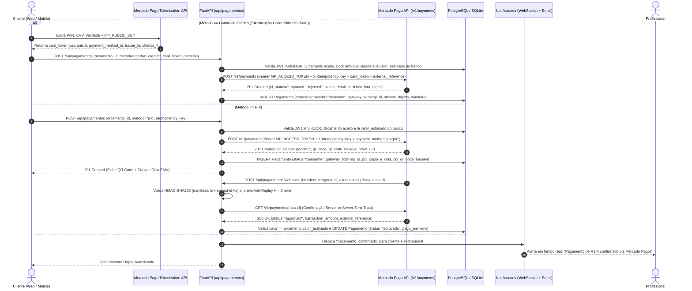
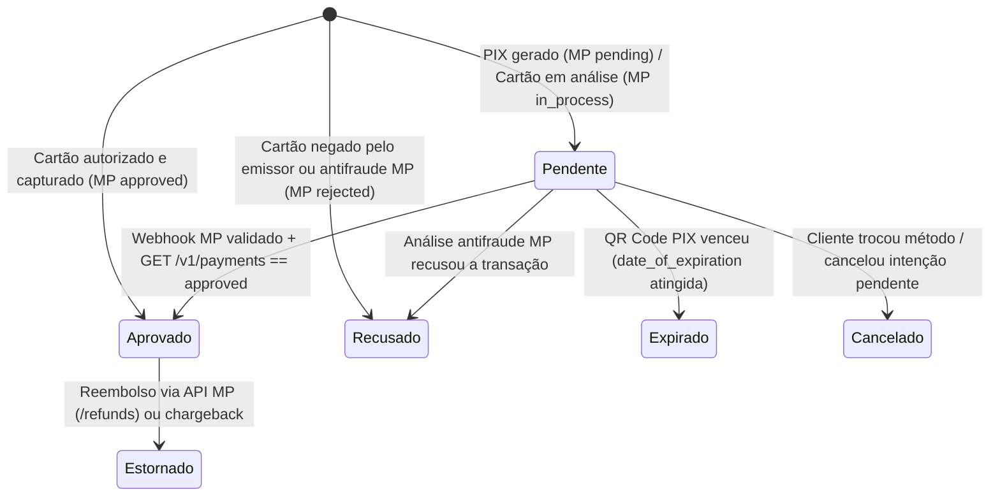

# 📋 PRD — Pagamento In-App via PIX e Cartão de Crédito com Mercado Pago API (História #9 / Issue #18)

| Metadado | Detalhe |
| :--- | :--- |
| **Projeto** | RentalSpouse — Plataforma de Serviços Residenciais ("Marido de Aluguel") |
| **Documento** | Product Requirements Document (PRD) — Pagamentos In-App (PIX & Cartão de Crédito) |
| **Arquivo** | `docs/PRD_Pagamentos_Issue18.md` / `PRD_Pagamentos_Issue18.md` |
| **Issue Relacionada** | GitHub Issue #18 — História de Usuário #9 |
| **Gateway Oficial** | **Mercado Pago API v1** (`https://api.mercadopago.com/v1/payments`) via `httpx` |
| **Integrações Internas** | `backend/models.py` (`Orcamento`, `Agendamento`, `Cliente`, `Professional`), `backend/notificacoes.py` |
| **Stack Alvo** | Backend (`FastAPI` + `SQLAlchemy 2.x` + `Pydantic v2` + `httpx`), Web (`Next.js 14`), Mobile (`React Native / Expo`) |
| **Segurança & Compliance** | PCI-DSS SAQ-A / SAQ-A EP (Tokenização Client-Side, Zero tráfego/armazenamento de PAN/CVV), Padrão EMV® BR Code (BACEN), `X-Idempotency-Key`, Assinatura HMAC-SHA256 (`x-signature` Mercado Pago) + Verificação Server-to-Server (Zero-Trust Webhook), LGPD |

---

## 1. Visão Geral e Contexto da História

> **História de Usuário (#9 / Issue #18)**:
> *"#9 SENDO um cliente, EU DEVO ter a opção de realizar o pagamento via PIX ou cartão de crédito pelo próprio aplicativo, PARA ter mais segurança e evitar lidar com dinheiro em espécie."*

### 1.1 Problema e Motivação
Atualmente, no fluxo do RentalSpouse:
1. O cliente solicita um orçamento (`backend/routes/orcamentos.py`) e o profissional responde/aceita definindo `valor_estimado` (`OrcamentoStatus.ACEITO` ou `RESPONDIDO`).
2. O cliente reserva um horário na agenda do profissional (`backend/routes/agendamentos.py`), podendo vincular `orcamento_id` ao `Agendamento`.
3. **Gap atual**: Não há camada financeira na plataforma. O acerto ocorre fora do aplicativo (dinheiro vivo ou transferência informal), expondo cliente e prestador a riscos de segurança física, golpes, falta de comprovante vinculado ao serviço e ausência de rastreabilidade em caso de denúncia (`DenunciaMotivo.COBRANCA_INDEVIDA` em `backend/models.py`).

### 1.2 Objetivos da Entrega
- Integrar a **API v1 de Pagamentos do Mercado Pago** (`POST /v1/payments`) para permitir que o **cliente autenticado** pague um orçamento aceito ou agendamento confirmado usando **PIX** (`payment_method_id: "pix"` com QR Code dinâmico e "Copia e Cola" EMV) ou **Cartão de Crédito** (à vista ou parcelado em até 12x, com tokenização client-side).
- Garantir **segurança máxima PCI-DSS (SAQ-A / SAQ-A EP)**: dados sensíveis do cartão (número completo `PAN` e `CVV`) são tokenizados diretamente no Mercado Pago pelo cliente (`card_token` descartável de uso único) e **jamais trafegam nem são persistidos** no backend/banco de dados do RentalSpouse.
- Validar notificações assíncronas (**Webhooks do Mercado Pago**) com verificação criptográfica HMAC-SHA256 (`x-signature`), proteção *Anti-Replay* por timestamp (`ts`), consulta cruzada *Server-to-Server* (`GET /v1/payments/{id}`) e disparo de notificações em tempo real (WebSocket + E-mail) para cliente e profissional.

---

## 2. Decisão Arquitetural: Mercado Pago API v1

A tecnologia definida para processamento de pagamentos é a **API REST v1 do Mercado Pago**, consumida pelo backend via `httpx` (já homologado no `backend/requirements.txt`, respeitando a diretriz do `AI_RULES.md` de não adicionar SDKs proprietários pesados sem necessidade).

### 2.1 Especificação da Integração com Mercado Pago
| Recurso | Endpoint / Mecanismo Mercado Pago | Aplicação no RentalSpouse |
| :--- | :--- | :--- |
| **Cobrança PIX** | `POST https://api.mercadopago.com/v1/payments` (`payment_method_id: "pix"`) | Gera `point_of_interaction.transaction_data.qr_code` (EMV Copia e Cola), `qr_code_base64` e `date_of_expiration`. |
| **Tokenização de Cartão (Frontend)** | MercadoPago.js v2 / Bricks ou `POST https://api.mercadopago.com/v1/card_tokens` (com `MP_PUBLIC_KEY`) | Converte PAN + CVV + Validade no dispositivo do cliente em um `card_token` descartável (TTL curto, uso único) + `device_session_id` antifraude. |
| **Cobrança Cartão (Backend)** | `POST https://api.mercadopago.com/v1/payments` (`token`, `installments`, `payment_method_id`, `issuer_id`) | Autoriza e captura a transação usando `MP_ACCESS_TOKEN` privado e header `X-Idempotency-Key`. |
| **Notificação Assíncrona (Webhook)** | Webhook `payment.created` / `payment.updated` com header `x-signature` e `x-request-id` | Valida assinatura HMAC-SHA256 do manifesto oficial do Mercado Pago e consulta `GET /v1/payments/{id}` antes de aprovar o pagamento. |
| **Isolamento em Testes (`pytest`)** | `MercadoPagoProvider` + `MercadoPagoMockTransport` (in-memory) | Permite que a suíte `pytest` rode 100% isolada e offline em SQLite `:memory:` simulando respostas idênticas ao contrato JSON v1 do Mercado Pago. |

### 2.2 Variáveis de Ambiente (`.env` / `.env.example`)
```ini
# --- Mercado Pago API (Pagamentos Issue #18) ---
# Modos: "mercadopago" (API real Sandbox/Produção do MP) ou "sandbox_mock" (simulador determinístico offline p/ dev/pytest)
PAYMENT_PROVIDER=mercadopago
MP_API_BASE_URL=https://api.mercadopago.com
# Chave privada Server-to-Server (TEST-... em Sandbox ou APP_USR-... em Produção). NUNCA expor no frontend!
MP_ACCESS_TOKEN=
# Chave pública para tokenização client-side do cartão no Web/Mobile
NEXT_PUBLIC_MP_PUBLIC_KEY=
EXPO_PUBLIC_MP_PUBLIC_KEY=
# Segredo para validação HMAC-SHA256 do header x-signature nos Webhooks do Mercado Pago
MP_WEBHOOK_SECRET=
# URL pública HTTPS para recebimento de Webhooks (notification_url)
MP_WEBHOOK_NOTIFICATION_URL=
# Tempo de expiração padrão do QR Code PIX em minutos (padrão: 30)
MP_PIX_EXPIRATION_MINUTES=30
```

---

## 3. Arquitetura e Fluxo Seguro de Pagamento



### 3.1 Máquina de Estados do Pagamento (`PagamentoStatus`) e Mapeamento Mercado Pago

| Status Interno (`PagamentoStatus`) | Status Mercado Pago (`status`) | Descrição / Gatilho de Transição |
| :--- | :--- | :--- |
| `pendente` | `pending`, `in_process`, `authorized` | QR Code PIX aguardando pagamento ou cartão em análise antifraude manual do Mercado Pago. |
| `aprovado` | `approved`, `accredited` | Pagamento confirmado e liquidado (captura imediata de cartão ou liquidação do PIX). |
| `recusado` | `rejected` | Negado pelo banco emissor ou pelo motor antifraude do Mercado Pago (`status_detail`). |
| `expirado` | `cancelled` (por `date_of_expiration`) | QR Code PIX venceu sem pagamento dentro da janela de 30 minutos. |
| `cancelado` | `cancelled` | Intenção anterior substituída pelo cliente antes da confirmação. |
| `estornado` | `refunded`, `charged_back` | Reembolso total/parcial via `POST /v1/payments/{id}/refunds` ou contestação. |



---

## 4. Modelo de Dados (`backend/models.py`)

Nova entidade `Pagamento` (e enums `PagamentoMetodo` e `PagamentoStatus`), desenhada seguindo os padrões de *Zero Card Storage* (PCI-DSS) e rastreabilidade do Mercado Pago:

```python
class PagamentoMetodo(str, enum.Enum):
    """Meios de pagamento aceitos via Mercado Pago (issue #18)."""
    PIX = "pix"
    CARTAO_CREDITO = "cartao_credito"


class PagamentoStatus(str, enum.Enum):
    """Ciclo de vida de uma transação de pagamento (issue #18)."""
    PENDENTE = "pendente"
    APROVADO = "aprovado"
    RECUSADO = "recusado"
    EXPIRADO = "expirado"
    CANCELADO = "cancelado"
    ESTORNADO = "estornado"
```

### Tabela: `pagamentos`
| Coluna | Tipo | Restrições | Descrição |
| :--- | :--- | :--- | :--- |
| `id` | `Integer` | PK, Auto Increment | Identificador interno do pagamento (`external_reference` no MP) |
| `orcamento_id` | `Integer` | FK(`orcamentos.id`, CASCADE), Not Null, Index | Orçamento cujo serviço está sendo pago |
| `agendamento_id` | `Integer` | FK(`agendamentos.id`, SET NULL), Nullable, Index | Agendamento associado (quando houver) |
| `cliente_id` | `Integer` | FK(`clientes.id`, CASCADE), Not Null, Index | Cliente pagador (extraído do token JWT) |
| `professional_id` | `Integer` | FK(`professionals.id`, CASCADE), Not Null, Index | Profissional recebedor vinculado ao orçamento |
| `valor` | `Numeric(10, 2)` / `Float` | Not Null, `CheckConstraint("valor > 0")` | Valor total em R$ (lido estritamente de `orcamento.valor_estimado`) |
| `metodo` | `String(30)` | Not Null, Index | `"pix"` ou `"cartao_credito"` |
| `status` | `String(30)` | Not Null, Default `"pendente"`, Index | Status interno sincronizado com o Mercado Pago |
| `parcelas` | `Integer` | Not Null, Default `1`, `CheckConstraint("parcelas >= 1 AND parcelas <= 12")` | Número de parcelas (`installments` no MP; `1` fixo para PIX) |
| `gateway_provider` | `String(50)` | Not Null, Default `"mercadopago"` | Identificador do provedor (`mercadopago` ou `sandbox_mock`) |
| `gateway_txid` | `String(120)` | Unique, Index, Not Null | `id` numérico/string da transação retornado pelo Mercado Pago (`/v1/payments`) |
| `external_reference` | `String(100)` | Index, Not Null | Referência cruzada enviada ao MP (`rs-orc-{orcamento_id}-pag-{uuid}`) |
| `idempotency_key` | `String(64)` | Unique, Index, Not Null | Chave enviada no header `X-Idempotency-Key` ao Mercado Pago |
| `pix_copia_e_cola` | `Text` | Nullable | Payload EMV® BR Code (`point_of_interaction.transaction_data.qr_code`) |
| `pix_qr_code_base64` | `Text` | Nullable | QR Code Base64 (`point_of_interaction.transaction_data.qr_code_base64`) |
| `pix_expira_em` | `DateTime` | Nullable | Timestamp UTC de expiração (`date_of_expiration`) |
| `cartao_ultimos_digitos` | `String(4)` | Nullable | Últimos 4 dígitos retornados pelo MP (`card.last_four_digits`) |
| `cartao_bandeira` | `String(30)` | Nullable | `payment_method_id` retornado pelo MP (`visa`, `master`, `elo`, `amex`, `hipercard`) |
| `cartao_nome_titular` | `String(100)` | Nullable | Nome do titular sanitizado (sem dados sensíveis) |
| `mp_status_detail` | `String(100)` | Nullable | Código `status_detail` do MP (ex.: `accredited`, `cc_rejected_high_risk`) |
| `motivo_recusa` | `String(255)` | Nullable | Mensagem amigável mapeada a partir do `status_detail` em caso de recusa |
| `pago_em` | `DateTime` | Nullable | Data/hora UTC da confirmação (`date_approved` do MP) |
| `criado_em` | `DateTime` | Not Null, Default UTC Now | Timestamp de criação |
| `atualizado_em` | `DateTime` | Not Null, Auto Update | Timestamp da última atualização |

> [!IMPORTANT]
> **Blindagem de Banco de Dados contra Cobrança Dupla (Anti Double-Charge)**:
> A tabela `pagamentos` possui um **índice único parcial** `uq_pagamentos_orcamento_aprovado` em `(orcamento_id)` onde `status = 'aprovado'`, além de constraint `UNIQUE` em `idempotency_key` e `gateway_txid`. Mesmo sob requisições concorrentes (*race condition*), o banco de dados impede fisicamente que um mesmo orçamento tenha dois pagamentos aprovados.

---

## 5. Especificação dos Endpoints REST (`backend/routes/pagamentos.py`)

### 5.1 Criar Pagamento via PIX ou Cartão (`POST /api/pagamentos`)
- **Autenticação**: Bearer Token de Cliente (`Depends(get_current_cliente)`)
- **Proteções e Regras de Negócio**:
  1. **Anti-IDOR**: Verifica se o `orcamento_id` existe e pertence ao `cliente` autenticado (`403 Forbidden` se pertencer a outro cliente; `404 Not Found` se inexistente).
  2. **Integridade do Orçamento**: Exige que o orçamento esteja em status `respondido` ou `aceito` e possua `valor_estimado > 0` (`422 Unprocessable Entity` caso contrário).
  3. **Fonte Única de Verdade para o Valor (Anti-Tampering)**: O campo `valor` **não existe no payload de entrada**. O backend extrai `valor = round(orcamento.valor_estimado, 2)` diretamente do banco de dados e o envia em `transaction_amount` para o Mercado Pago.
  4. **Idempotência Ponta a Ponta**:
     - Se o cliente reenviar a mesma `idempotency_key` já processada para o mesmo orçamento e método, retorna a transação existente sem criar nova cobrança.
     - Na chamada HTTP ao Mercado Pago (`POST https://api.mercadopago.com/v1/payments`), envia o cabeçalho oficial `X-Idempotency-Key: <idempotency_key>`.
  5. **Bloqueio de Duplicidade**: Se já existir pagamento `aprovado` para o `orcamento_id`, retorna `409 Conflict`. Se existir pagamento `pendente` anterior, cancela a intenção anterior no Mercado Pago (`PUT /v1/payments/{id}` com `status: "cancelled"`) e marca localmente como `cancelado`.
  6. **Fluxo PIX (`metodo == "pix"`)**:
     - Chama `POST /v1/payments` no Mercado Pago com `payment_method_id: "pix"`, `transaction_amount`, `description`, `external_reference`, `notification_url` e `payer` (e-mail, nome e CPF do `Cliente` autenticado).
     - Persiste `gateway_txid = str(mp_response["id"])`, `pix_copia_e_cola`, `pix_qr_code_base64`, `pix_expira_em` e retorna `201 Created` com `status = "pendente"`.
  7. **Fluxo Cartão de Crédito (`metodo == "cartao_credito"`)**:
     - **Bloqueio PCI-DSS Estrito**: O schema Pydantic (`CartaoTokenizadoInput`) usa `extra = "forbid"` e **rejeita com `422 Unprocessable Entity` qualquer tentativa de enviar `numero_cartao`, `pan` ou `cvv` ao backend**.
     - Recebe apenas o `card_token` (gerado no frontend via Mercado Pago Public Key), `payment_method_id` (`visa`, `master`, `elo`, etc.), `issuer_id` (opcional), `parcelas` (`1` a `12`), `nome_titular`, `cpf_titular` e `device_session_id` (opcional, enviado ao MP via header `X-meli-session-id`).
     - Chama `POST /v1/payments` no Mercado Pago com `token: card_token`, `installments: parcelas`, `capture: True`, `binary_mode: True` (força decisão imediata `approved` ou `rejected` sem estados intermediários ambíguos quando aplicável).
     - Grava apenas `cartao_ultimos_digitos` e `cartao_bandeira` retornados pela resposta oficial do Mercado Pago.

#### Exemplo de Payload — PIX (`PagamentoCreate`):
```json
{
  "orcamento_id": 42,
  "agendamento_id": 15,
  "metodo": "pix",
  "idempotency_key": "550e8400-e29b-41d4-a716-446655440000"
}
```

#### Exemplo de Payload — Cartão de Crédito Tokenizado (`PagamentoCreate`):
```json
{
  "orcamento_id": 42,
  "agendamento_id": 15,
  "metodo": "cartao_credito",
  "parcelas": 3,
  "idempotency_key": "660e8400-e29b-41d4-a716-446655440111",
  "cartao": {
    "card_token": "ff8080814c11e237014c1ff593b57b4d",
    "payment_method_id": "master",
    "issuer_id": "24",
    "nome_titular": "MARIANA FERREIRA",
    "cpf_titular": "12345678909",
    "device_session_id": "mp_device_fingerprint_98a7b6c5"
  }
}
```
> [!CAUTION]
> **Proibição de Dados Sensíveis no Backend**:
> O backend **jamais** recebe `numero_cartao`, `cvv` ou `validade`. Caso um cliente mal-intencionado ou desatualizado envie esses campos no JSON, o Pydantic rejeitará imediatamente a requisição (`extra="forbid"`) antes de qualquer processamento, mantendo o backend fora do escopo de armazenamento/tráfego de dados de portador do PCI-DSS.

#### Exemplo de Resposta (`201 Created` — `PagamentoRead`):
```json
{
  "id": 101,
  "orcamento_id": 42,
  "agendamento_id": 15,
  "cliente_id": 7,
  "professional_id": 12,
  "valor": 250.0,
  "metodo": "pix",
  "status": "pendente",
  "parcelas": 1,
  "valor_parcela": 250.0,
  "gateway_provider": "mercadopago",
  "gateway_txid": "84930219482",
  "external_reference": "rs-orc-42-pag-101",
  "pix_copia_e_cola": "00020126580014br.gov.bcb.pix0136...",
  "pix_qr_code_base64": "iVBORw0KGgoAAAANSUhEUgAAB4AAAAeACAYAAAB...",
  "pix_expira_em": "2026-11-04T21:30:00Z",
  "cartao_ultimos_digitos": null,
  "cartao_bandeira": null,
  "cartao_nome_titular": null,
  "mp_status_detail": "pending_waiting_transfer",
  "motivo_recusa": null,
  "pago_em": null,
  "criado_em": "2026-11-04T21:00:00Z"
}
```

---

### 5.2 Webhook Oficial do Mercado Pago (`POST /api/pagamentos/webhook`)
O Mercado Pago envia notificações de eventos (`type: "payment"`, `action: "payment.updated"` ou `"payment.created"`) para o endpoint configurado em `notification_url`.

#### Protocolo de Segurança de 4 Camadas no Webhook:
1. **Camada 1 — Extração e Validação Estrutural dos Headers**:
   - Exige os cabeçalhos `x-signature` (formato `ts=1730764800,v1=a1b2c3...`) e `x-request-id`.
   - Extrai `data.id` da query string (`?data.id=...`) ou do corpo JSON (`body["data"]["id"]`). Em conformidade com a documentação do Mercado Pago, se `data.id` for alfanumérico, converte para minúsculas no manifesto.
2. **Camada 2 — Proteção Anti-Replay Temporal (`ts`)**:
   - Verifica se `abs(time.time() - int(ts)) <= 300` (tolerância máxima de 5 minutos). Notificações antigas retransmitidas por atacantes (*Replay Attack*) são rejeitadas com `401 Unauthorized`.
3. **Camada 3 — Verificação Criptográfica HMAC-SHA256 em Tempo Constante**:
   - Constrói a string de manifesto exatamente no padrão do Mercado Pago:
     ```text
     id:{data_id};request-id:{x_request_id};ts:{ts};
     ```
   - Calcula `expected_v1 = hmac.new(MP_WEBHOOK_SECRET.encode("utf-8"), manifest.encode("utf-8"), hashlib.sha256).hexdigest()`.
   - Compara usando `hmac.compare_digest(received_v1, expected_v1)` (prevenindo *Timing Side-Channel Attacks*). Se inválido, registra alerta de segurança no log e retorna `401 Unauthorized`.
4. **Camada 4 — Verificação Server-to-Server (Zero-Trust / Fetch-Before-Trust)**:
   - O backend **não confia apenas no corpo do webhook**. Após validar o HMAC, faz uma requisição autenticada `GET https://api.mercadopago.com/v1/payments/{data_id}` com `Authorization: Bearer {MP_ACCESS_TOKEN}`.
   - Confirma que:
     - O pagamento existe no Mercado Pago;
     - `external_reference` corresponde ao registro de `Pagamento` no banco;
     - `transaction_amount` no Mercado Pago é exatamente igual a `pagamento.valor` (prevenindo fraude de pagamento parcial);
     - Atualiza o `status` (`aprovado`, `recusado`, `cancelado`, `estornado`) de forma idempotente e dispara a notificação WebSocket + E-mail se houve transição para `aprovado`.

> [!NOTE]
> **Rota Auxiliar de Simulação Restrita a Dev/Test (`POST /api/pagamentos/{pagamento_id}/simular-aprovacao`)**:
> Disponível **exclusivamente** quando `PAYMENT_PROVIDER == "sandbox_mock"` (bloqueada com `403 Forbidden` quando em produção/Mercado Pago real), permitindo testar e demonstrar a confirmação do PIX offline durante a avaliação acadêmica e na suíte `pytest`.

---

### 5.3 Consultar Detalhes e Status do Pagamento (`GET /api/pagamentos/{pagamento_id}`)
- **Autenticação**: Cliente dono do pagamento, Profissional recebedor ou Admin (`get_current_user`). Restrição estrita Anti-IDOR.
- **Sincronização Ativa Opcional**: Se o pagamento estiver `pendente` e já tiver passado da `pix_expira_em`, atualiza automaticamente para `expirado`.

---

### 5.4 Listar Histórico de Pagamentos (`GET /api/pagamentos/meus`)
- **Autenticação**: Bearer Token (Cliente vê apenas pagamentos em que `cliente_id == current_user.id`; Profissional vê apenas pagamentos em que `professional_id == current_user.id`).
- **Filtros Query**: `status`, `metodo`, `orcamento_id`, `skip` (default `0`), `limit` (default `20`, máx `100`).

---

## 6. Experiência do Usuário (Frontend Web & Mobile) com Mercado Pago

### 6.1 Fluxo na Web (`web/`) e Mobile (`mobile/`)
1. **Botão "Pagar com Mercado Pago"**:
   - Exibido nos cards de Orçamentos Aceitos/Respondidos (`status in ['aceito', 'respondido']` e `valor_estimado > 0`) e na tela de Meus Agendamentos.
2. **Modal / Tela de Checkout (`PaymentCheckoutModal.tsx`)**:
   - **Resumo Seguro do Serviço**: Exibe nome do profissional, descrição do orçamento, selo *"Processado com segurança via Mercado Pago"* e valor total bloqueado (somente leitura).
   - **Aba PIX (Instantâneo — Mercado Pago)**:
     - Ao selecionar PIX, chama `POST /api/pagamentos` e renderiza o `pix_qr_code_base64` oficial gerado pelo Mercado Pago + botão **"Copiar código PIX (Copia e Cola)"**.
     - Exibe contador regressivo até `pix_expira_em` e escuta o evento WebSocket `pagamento_confirmado` (com fallback de polling leve a cada 5s).
   - **Aba Cartão de Crédito (Tokenização Client-Side)**:
     - Utiliza o SDK JS oficial `@mercadopago/sdk-react` / `MercadoPago.js v2` (ou chamada direta `POST https://api.mercadopago.com/v1/card_tokens?public_key=...` no Mobile/Web) para tokenizar os dados do cartão no navegador/app do cliente.
     - O formulário coleta Número do Cartão, Nome do Titular, CPF do Titular, Validade (`MM/AA`), CVV e Parcelas (`1x` a `12x`), gera o `card_token` junto ao Mercado Pago e envia **apenas o `card_token`** para `POST /api/pagamentos` no backend da RentalSpouse.
     - Limpa imediatamente os campos de cartão da memória do componente React após a tokenização.
   - **Comprovante Digital**:
     - Exibe status aprovado, ID da transação no Mercado Pago (`gateway_txid`), referência (`external_reference`), data/hora, método e últimos 4 dígitos (se cartão).

---

## 7. Matriz Completa de Segurança e Conformidade (Security-by-Design)

| # | Controle de Segurança | Ameaça Mitigada | Implementação Técnica no RentalSpouse |
| :--- | :--- | :--- | :--- |
| **1** | **Tokenização Client-Side & Zero Card Storage (PCI-DSS SAQ-A / EP)** | Vazamento de dados de cartão (PAN/CVV) em banco de dados, logs ou memória do servidor | O backend nunca recebe nem armazena `numero_cartao` ou `cvv`. O schema Pydantic usa `extra="forbid"` e aceita apenas `card_token` descartável do Mercado Pago. |
| **2** | **Segregação Estrita de Credenciais (`MP_ACCESS_TOKEN` vs `MP_PUBLIC_KEY`)** | Exposição de chave privada de movimentação financeira no bundle JS/Mobile | `MP_ACCESS_TOKEN` existe apenas nas variáveis de ambiente do container backend. O frontend recebe apenas a `PUBLIC_KEY` (que só tem permissão para criar tokens de cartão). |
| **3** | **Validação HMAC-SHA256 (`x-signature`) + `hmac.compare_digest`** | Falsificação de confirmação de pagamento (*Webhook Spoofing* e *Timing Attacks*) | Valida o manifesto `id:{data.id};request-id:{x-request-id};ts:{ts};` com `MP_WEBHOOK_SECRET` usando comparação em tempo constante. |
| **4** | **Janela Temporal Anti-Replay no Webhook (`ts`)** | Reenvio malicioso de webhooks antigos capturados (*Replay Attack*) | Rejeita qualquer webhook cujo timestamp `ts` tenha diferença superior a 300 segundos (5 minutos) em relação ao relógio UTC do servidor. |
| **5** | **Verificação Cruzada Server-to-Server (Zero-Trust Webhook)** | Injeção de payload adulterado ou inconsistência de estado no webhook | Mesmo com HMAC válido, o backend consulta `GET /v1/payments/{id}` na API do Mercado Pago e confere `status`, `transaction_amount == pagamento.valor` e `external_reference`. |
| **6** | **Imutabilidade do Valor no Servidor (OWASP API3)** | Manipulação de preço pelo cliente (ex.: alterar payload para pagar `R$ 0,01`) | O endpoint `POST /api/pagamentos` ignora/rejeita qualquer campo de valor no request e lê `orcamento.valor_estimado` exclusivamente do banco de dados. |
| **7** | **Autorização de Propriedade Anti-IDOR (OWASP API1)** | Cliente pagar, consultar ou cancelar pagamento de orçamento de terceiros | Todas as rotas validam `orcamento.cliente_id == current_cliente.id` (ou `professional_id == current_prof.id` na leitura). |
| **8** | **Idempotência Dupla (`X-Idempotency-Key` + Unique Partial Index)** | Cobrança duplicada em cliques duplos, retentativas de rede ou concorrência | Envia `X-Idempotency-Key` ao Mercado Pago, valida `idempotency_key` única no banco e aplica índice único parcial `WHERE status = 'aprovado'` por `orcamento_id`. |
| **9** | **Modo Binário e Antifraude (`binary_mode` + `X-meli-session-id`)** | Fraude com cartões clonados (*Carding*) e estados pendentes indefinidos em cartão | Envia o device fingerprint (`X-meli-session-id`), CPF validado do pagador e `binary_mode: true` na criação do pagamento via cartão no Mercado Pago. |
| **10** | **Rate Limiting Anti-Carding** | Ataques automatizados de teste de cartões roubados (*Card Testing* / *Brute Force*) | Limite de tentativas de criação de pagamento por IP e por `cliente_id` (ex.: máx. 5 tentativas por minuto por usuário). |
| **11** | **Sanitização de Logs e Erros (LGPD & PCI)** | Vazamento de tokens, CPF ou segredos em logs de aplicação ou respostas HTTP 500 | Logs registram apenas `pagamento.id`, `orcamento_id`, `gateway_txid` e `status`. Erros de rede/API do Mercado Pago nunca vazam headers de `Authorization`. |

---

## 8. Critérios de Aceite (BDD / Gherkin)

### Cenário 1: Geração de cobrança PIX via Mercado Pago e confirmação segura por Webhook
```gherkin
Dado que o cliente autenticado possui um orçamento "aceito" no valor de R$ 180,00
Quando ele envia POST "/api/pagamentos" escolhendo o método "pix" com uma "idempotency_key" válida
Então o backend deve chamar a API do Mercado Pago ("/v1/payments") enviando "X-Idempotency-Key" e "transaction_amount" igual a 180.00
E deve responder com HTTP 201 Created contendo "gateway_txid", "pix_copia_e_cola", "pix_qr_code_base64" e "status" igual a "pendente"
E quando o Mercado Pago enviar POST "/api/pagamentos/webhook" com "x-signature" HMAC-SHA256 válido e timestamp dentro de 5 minutos
Então o backend deve validar a assinatura, consultar "GET /v1/payments/{id}" no Mercado Pago conferindo o valor de R$ 180,00
E atualizar o status do pagamento para "aprovado" preenchendo "pago_em"
E disparar uma notificação em tempo real "pagamento_confirmado" para o profissional e para o cliente.
```

### Cenário 2: Pagamento com Cartão de Crédito via `card_token` do Mercado Pago (Zero PAN/CVV no Backend)
```gherkin
Dado que o cliente autenticado possui um orçamento "aceito" no valor de R$ 300,00
E o frontend tokenizou o cartão no Mercado Pago gerando um "card_token" de uso único
Quando ele envia POST "/api/pagamentos" com método "cartao_credito", 3 parcelas e o "card_token"
Então o backend deve processar a cobrança no Mercado Pago em modo binário sem receber o número completo do cartão ou CVV
E deve responder com HTTP 201 Created com "status" igual a "aprovado", "parcelas" igual a 3 e "valor_parcela" igual a 100.00
E o banco de dados deve persistir apenas os 4 últimos dígitos e a bandeira retornados pelo Mercado Pago.
```

### Cenário 3: Rejeição imediata se o payload tentar enviar PAN ou CVV para o Backend (Proteção PCI-DSS)
```gherkin
Dado que uma requisição malformada ou maliciosa tenta enviar "numero_cartao" ou "cvv" no corpo de POST "/api/pagamentos"
Quando o backend recebe a requisição
Então o schema Pydantic deve rejeitar o payload imediatamente com HTTP 422 Unprocessable Entity
E nenhuma chamada ao gateway ou gravação no banco deve ser realizada.
```

### Cenário 4: Rejeição de Webhook com assinatura HMAC inválida ou Replay Attack
```gherkin
Dado que existe um pagamento PIX com status "pendente"
Quando o endpoint POST "/api/pagamentos/webhook" recebe uma requisição sem "x-signature", com HMAC inválido ou com timestamp "ts" expirado há mais de 5 minutos
Então o servidor deve rejeitar a requisição com HTTP 401 Unauthorized
E o status do pagamento deve permanecer inalterado como "pendente".
```

### Cenário 5: Bloqueio de pagamento duplicado e proteção do valor no servidor
```gherkin
Dado que o orçamento #42 já possui um pagamento com status "aprovado"
Quando o cliente tenta criar um novo pagamento para o orçamento #42 com outra chave de idempotência
Então o servidor deve rejeitar a requisição com HTTP 409 Conflict informando que o orçamento já está pago.
```

---

## 9. Plano de Implementação Sugerido

| Etapa | Escopo | Arquivos Afetados |
| :--- | :--- | :--- |
| **Fase 1: Banco, Config & Schemas PCI-Safe** | Modelos `Pagamento`, `PagamentoMetodo`, `PagamentoStatus`, índice único parcial em `models.py`, migração em `migrations.py`, variáveis `MP_*` no `.env.example` e DTOs Pydantic v2 em `schemas.py` (`extra="forbid"`, validação de CPF e `card_token`). | `backend/models.py`, `backend/migrations.py`, `backend/schemas.py`, `.env.example` |
| **Fase 2: Cliente Mercado Pago & Segurança de Webhook** | Módulo `backend/payment_gateway.py` implementando `MercadoPagoProvider` (via `httpx` com `X-Idempotency-Key`, validação HMAC-SHA256 `x-signature` + anti-replay `ts` + `GET /v1/payments/{id}`) e `MercadoPagoSandboxMockProvider` para testes offline. | `backend/payment_gateway.py`, `backend/routes/pagamentos.py`, `backend/main.py` |
| **Fase 3: Suíte de Testes Automatizados (`pytest`)** | Testes em `backend/tests/test_pagamentos.py` cobrindo PIX, Cartão aprovado/recusado, bloqueio de PAN/CVV no backend, validação de assinatura HMAC do Webhook, Anti-Replay, Anti-IDOR, Anti-Tampering de valor, Idempotência e WebSocket. | `backend/tests/test_pagamentos.py` |
| **Fase 4: Frontend Web & Mobile (Tokenização MP)** | Integração de tokenização client-side com `NEXT_PUBLIC_MP_PUBLIC_KEY` / `EXPO_PUBLIC_MP_PUBLIC_KEY`, modal de checkout PIX + Cartão e comprovante digital. | `web/services/pagamentos.ts`, `web/components/pagamentos/PaymentCheckoutModal.tsx`, `mobile/screens/...` |
