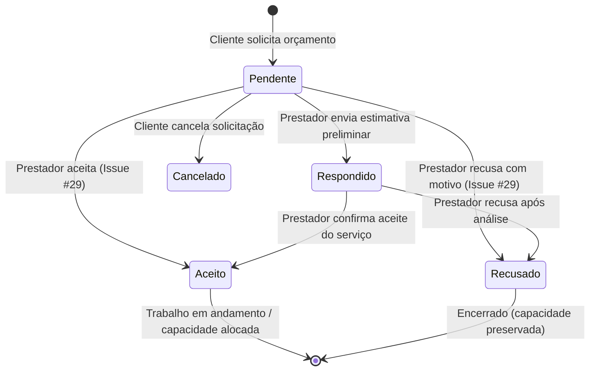

# Gestão de Capacidade e Ciclo de Vida de Orçamentos (Issue #29)

> **História de Usuário (#6 / Issue #29)**:  
> *"COMO um prestador de serviços, EU DEVO poder aceitar ou recusar solicitações de orçamento, PARA conseguir gerenciar minha própria capacidade de trabalho."*

---

## 1. Visão Geral da Arquitetura

O módulo de Gestão de Capacidade e Orçamentos permite que prestadores de serviço autenticados tenham controle total sobre sua demanda de atendimento. A partir da notificação em tempo real ou do painel de controle `/profissional/orcamentos`, o profissional pode:

1. **Aceitar** uma solicitação de orçamento (`status = "aceito"`), com estimativa preliminar opcional, data/horário sugerido para visita ou realização do serviço e mensagem/orientações ao cliente.
2. **Recusar** uma solicitação (`status = "recusado"`), registrando obrigatoriamente um motivo categorizado (ex: *Agenda lotada / Sem capacidade no período*, *Fora da região*, etc.) e justificativa detalhada opcional.
3. **Monitorar sua capacidade ativa** através de métricas em tempo real (`GET /api/orcamentos/capacidade/resumo`), visualizando o volume de orçamentos pendentes, aceitos (compromissos assumidos) e recusados.

---

## 2. Máquina de Estados do Orçamento (`OrcamentoStatus`)



### Regras de Transição e Validação:
- **Transições Permitidas**:
  - `pendente` -> `aceito`
  - `pendente` -> `recusado`
  - `pendente` -> `respondido`
  - `respondido` -> `aceito`
  - `respondido` -> `recusado`
- **Estados Terminais / Bloqueios**:
  - Um orçamento já `recusado` não pode ser aceito nem recusado novamente (retorna `400 Bad Request`).
  - Um orçamento já `aceito` não pode ser recusado nem aceito novamente (retorna `400 Bad Request`).
  - Um orçamento cancelado pelo cliente (`cancelado`) não pode sofrer alteração de status pelo profissional (retorna `400 Bad Request`).
- **Controle de Acesso Estrito (Anti-IDOR)**:
  - Apenas o profissional destinatário (`professional_id == current_user.professional.id`) ou administradores (`role == 'admin'`) podem aceitar ou recusar orçamentos (retorna `403 Forbidden` para outros usuários).

---

## 3. Endpoints RESTful

### 3.1 Aceitar Orçamento
- **Rota**: `PATCH /api/orcamentos/{orcamento_id}/aceitar`
- **Autenticação**: Bearer Token (Profissional destinatário ou Admin)
- **Payload (`OrcamentoAceitar`)**:
  ```json
  {
    "valor_estimado": 250.00,
    "data_prevista": "2026-10-20T14:00:00Z",
    "mensagem": "Orçamento aceito! Levarei os materiais necessários para a instalação."
  }
  ```
- **Respostas**:
  - `200 OK`: Retorna `OrcamentoRead` com `status: "aceito"`, `decidido_em` e `data_prevista`.
  - `400 Bad Request`: Transição inválida (já aceito, recusado ou cancelado).
  - `403 Forbidden`: Usuário logado não é o destinatário do orçamento.
  - `404 Not Found`: Orçamento inexistente.

### 3.2 Recusar Orçamento
- **Rota**: `PATCH /api/orcamentos/{orcamento_id}/recusar`
- **Autenticação**: Bearer Token (Profissional destinatário ou Admin)
- **Payload (`OrcamentoRecusar`)**:
  ```json
  {
    "motivo": "Agenda lotada / Sem capacidade no período",
    "justificativa_detalhada": "Minha agenda técnica está completamente alocada para os próximos 15 dias."
  }
  ```
- **Respostas**:
  - `200 OK`: Retorna `OrcamentoRead` com `status: "recusado"`, `motivo_recusa`, `justificativa_recusa` e `decidido_em`.
  - `400 Bad Request`: Transição inválida.
  - `422 Unprocessable Entity`: Campo `motivo` ausente ou menor que 3 caracteres.
  - `403 Forbidden`: Usuário não autorizado.
  - `404 Not Found`: Orçamento inexistente.

### 3.3 Resumo de Capacidade do Prestador
- **Rota**: `GET /api/orcamentos/capacidade/resumo`
- **Autenticação**: Bearer Token (Profissional ou Admin)
- **Resposta (`OrcamentoResumoCapacidade`)**:
  ```json
  {
    "total": 12,
    "pendentes": 3,
    "aceitos": 7,
    "recusados": 2,
    "respondidos": 0
  }
  ```

---

## 4. Notificações em Tempo Real e Background Tasks

Ao aceitar ou recusar uma solicitação:
1. **Banco de Dados**: Registro automático na tabela `notificacoes` com `tipo = "orcamento_aceito"` ou `tipo = "orcamento_recusado"` vinculado ao e-mail do cliente solicitante.
2. **WebSocket Nativo**: Envio em tempo real via hub (`/api/ws/notificacoes`) para atualizar instantaneamente o navegador do cliente.
3. **E-mail Transacional**: Disparo não-bloqueante em `BackgroundTasks` notificando o cliente sobre o aceite com instruções, ou sobre a recusa com a justificativa apresentada.

---

## 5. Interface Web (Frontend)

- **Painel `/profissional/orcamentos`**:
  - Exibição de 4 cartões de capacidade: *Pendentes*, *Aceitos (Capacidade Ativa)*, *Recusados* e *Total*.
  - Abas de filtro instantâneo por status (`Todos`, `Pendentes`, `Aceitos`, `Recusados`, `Respondidos`).
  - Cards detalhados de cada orçamento com dados do cliente, fotos em miniatura, lightbox de zoom e botões de ação rápida.
- **Componente `QuoteDetailModal`**:
  - Modos dedicados para *Aceitar Orçamento*, *Recusar Orçamento* e *Enviar Estimativa*.
  - Suporte completo a foco acessível, fechamento via tecla Escape, tratamento visual dos estados de carregamento, erro e sucesso.
- **Header e Dropdown (`NotificationBell`)**:
  - Atalho direto no rodapé do sino de notificações para navegar até `/profissional/orcamentos`.
  - Link dinâmico "Meus Orçamentos" na barra superior de navegação para profissionais autenticados.

---

## 6. Cobertura de Testes Automatizados

- Suíte `backend/tests/test_orcamentos.py` expandida para **30 testes unitários e de integração**.
- Validação rigorosa com SQLite em memória (`DATABASE_URL = "sqlite:///:memory:"`):
  - Fluxos felizes de aceite com ou sem valor estimado preliminar e data agendada.
  - Fluxos felizes de recusa com motivo categorizado e texto detalhado.
  - Testes de segurança IDOR (403), não-autenticado (401) e 404.
  - Testes de regras de transição de estado defensivas (400).
  - Testes de consolidação de capacidade e filtros por query string.
- Cobertura global do backend mantida em **95.62%** com **359 testes passando (100% de sucesso)**.
- Compilação do frontend Next.js validada com **100% de sucesso**.
